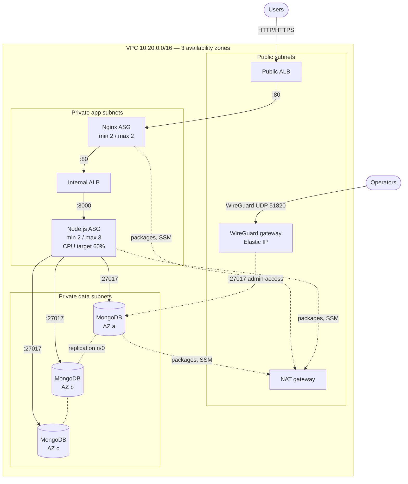

# AWS three-tier platform — Terraform

[](https://github.com/santoshmyakala/aws-three-tier-platform/actions/workflows/terraform.yml)


A production-style, highly available **web → app → database** platform on AWS, defined entirely in Terraform:

- an internet-facing ALB in front of an **Nginx** auto-scaling group;
- an internal ALB in front of a **Node.js** auto-scaling group;
- a three-member **MongoDB replica set**, one member per availability zone;
- a **WireGuard VPN** gateway for operator access to the private tiers.

Every tier accepts traffic only from the tier in front of it. Instances run without SSH keys and are managed through AWS Systems Manager.

> This is a clean rebuild of an earlier exercise of mine (2021). The original had hard-coded credentials and only partly implemented the design. This version keeps the same requirements and builds them properly.

## Architecture



### Security groups

| From → To | Port | Rule |
|---|---|---|
| Internet → public ALB | 80 (and 443 with a certificate) | `0.0.0.0/0` |
| Public ALB → Nginx | 80 | security-group reference |
| Nginx → internal ALB | 80 | security-group reference |
| Internal ALB → Node.js | 3000 | security-group reference |
| Node.js, VPN, replica members → MongoDB | 27017 | security-group references only — no CIDR rules |
| Allowed client CIDRs → VPN | UDP 51820 | `var.vpn_allowed_cidrs` (validated, required) |

No security group opens port 22.

## What's in it

| File | Contents |
|---|---|
| `network.tf` | VPC, 9 subnets (3 tiers × 3 AZs), IGW, NAT (single or per-AZ), route tables, VPC flow logs |
| `security.tf` | One security group per tier, rules as above |
| `compute.tf` | ALBs, launch templates, ASGs with rolling instance refresh, CPU target tracking, MongoDB instances, VPN gateway |
| `iam.tf` | SSM-only instance role; flow-logs role scoped to its log group |
| `templates/` | cloud-init user data for Nginx, the Node.js app, MongoDB 8.0 and WireGuard |
| `tests/plan.tftest.hcl` | Offline `terraform test` suite with a mocked AWS provider |
| `scripts/init-replica-set.sh` | One-off replica-set initiation via SSM Run Command |

### Hardening built in

- IMDSv2 required on every instance; hop limit 1.
- Encrypted gp3 volumes everywhere.
- Load balancers drop invalid headers. With `certificate_arn` set, they serve TLS 1.3/1.2 (`ELBSecurityPolicy-TLS13-1-2-2021-06`) and redirect HTTP to HTTPS.
- VPC flow logs go to CloudWatch with 30-day retention.
- WireGuard server keys are generated on the instance at first boot and are never stored in Terraform state.
- The commented S3 backend uses native S3 state locking (`use_lockfile`), so no DynamoDB table is needed.

## Usage

Prerequisites: Terraform ≥ 1.6, AWS credentials for an account you control, `jq`, and the AWS CLI with the Session Manager plugin.

```bash
cd terraform
cp terraform.tfvars.example terraform.tfvars   # set vpn_allowed_cidrs to your IP
terraform init
```

```bash
terraform plan -out tfplan
```

```bash
terraform apply tfplan
```

Once the MongoDB instances have finished booting (a few minutes), initiate the replica set:

```bash
../scripts/init-replica-set.sh
```

```bash
curl "$(terraform output -raw url)"
# {"host":"ip-10-20-...","mongo":"connected","visits":1}
```

Refresh a few times: `host` changes as the ALBs spread requests across instances, and `visits` comes from the replica set.

When you're done, tear everything down:

```bash
terraform destroy
```

### Adding a VPN client

1. Generate a key pair on your laptop: `wg genkey | tee client.key | wg pubkey > client.pub`
2. Read the server's public key: `aws ssm start-session --target $(terraform output -raw vpn_instance_id)`, then `sudo cat /etc/wireguard/server.pub`.
3. Register the client on the server: `sudo wg set wg0 peer <client.pub> allowed-ips 10.99.0.2/32`
4. Create the client config, with `Endpoint = $(terraform output -raw vpn_endpoint)` and `AllowedIPs = 10.20.0.0/16`.

### Cost note

This creates billable resources: two ALBs, a NAT gateway, 9–10 EC2 instances and an Elastic IP. Run `terraform destroy` when you finish experimenting.

## Testing and CI

| Check | Command | Runs in CI |
|---|---|---|
| Formatting | `terraform fmt -check -recursive` | ✅ |
| Validation | `terraform validate` | ✅ |
| Plan-level tests (mocked AWS, no credentials) | `terraform test` | ✅ |
| Linting | `tflint --recursive` | ✅ |
| Shell scripts | `shellcheck` | ✅ |
| IaC misconfiguration scan | Trivy (`.trivyignore` documents accepted findings) | ✅ |

`terraform test` plans the whole stack offline and asserts that:
- the subnets cover three AZs, the replica set has three members, and the auto-scaling groups have the required sizes;
- IMDSv2 is enforced, database volumes are encrypted, MongoDB has no CIDR-based ingress, and the VPN isn't open to `0.0.0.0/0`;
- an HTTPS listener and HTTP redirect appear when a certificate is supplied;
- `single_nat_gateway = false` creates one NAT gateway per AZ;
- an empty VPN allowlist is rejected.

```
$ terraform test
  run "three_az_layout"... pass
  run "security_baseline"... pass
  run "https_when_certificate_given"... pass
  run "multi_az_nat"... pass
  run "rejects_empty_vpn_allowlist"... pass
Success! 5 passed, 0 failed.
```

## Roadmap

- [ ] Enable MongoDB authentication: a keyfile in Secrets Manager plus SCRAM users.
- [ ] Automate MongoDB backups with AWS Backup EBS snapshots.
- [ ] Add AWS WAF on the public ALB.
- [ ] Split into reusable modules (`network`, `tier`, `replica-set`) and add a second environment.
- [ ] Add an OIDC-federated GitHub Actions role for `plan` on pull requests.

## Licence

MIT
